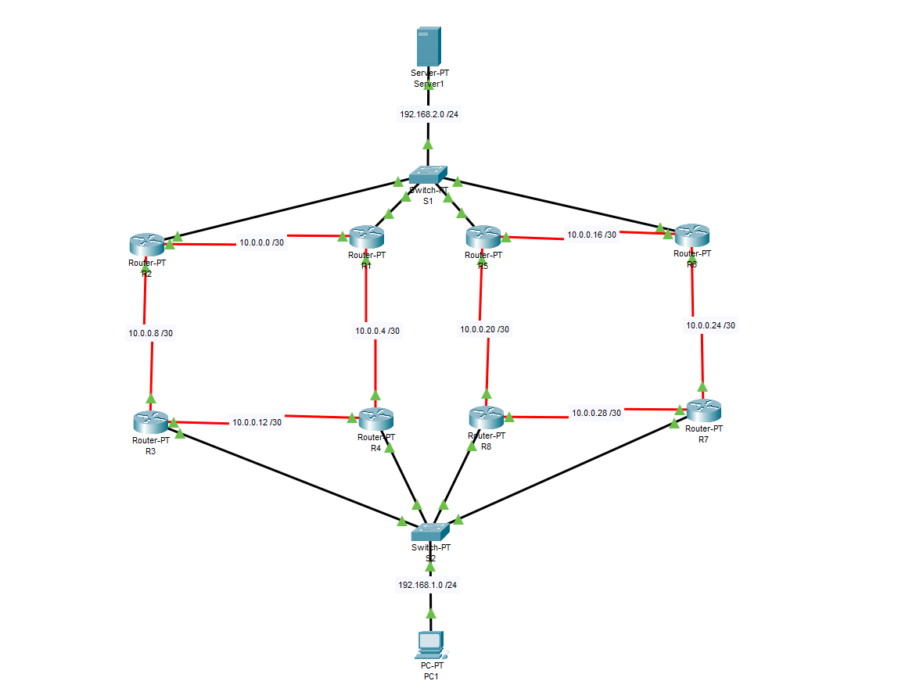

# Cisco Network Design – Routing and Redundancy

## Project Overview

This project was developed using Cisco Packet Tracer to design
and configure a network with multiple interconnected routers
and LANs. The goal was to establish reliable communication
between networks and demonstrate how dynamic routing can
maintain connectivity when network paths become unavailable.

## Network Topology

## Technologies Used

- Cisco Packet Tracer
- Cisco IOS
- RIPv2 Dynamic Routing
- IPv4 Addressing and Subnetting
- Network Troubleshooting

## Project Implementation

- Designed a network topology with multiple interconnected
  routers and LANs.
- Configured router interfaces with IPv4 addresses and
  appropriate subnet masks.
- Implemented RIPv2 to dynamically exchange routing
  information between routers.
- Configured routing interfaces to establish communication
  between different networks.
- Verified end-to-end connectivity using ping tests and
  Cisco IOS commands.
- Simulated a network link failure to observe routing
  convergence and alternate path selection.

## Network Redundancy

One of the main objectives of this project was to demonstrate
network redundancy using dynamic routing.

By implementing RIPv2, routers were able to exchange routing
information and automatically update their routing tables
when network conditions changed.

To test redundancy, a connection between two routers was
disabled. The network was then tested to verify that traffic
could reach its destination through an alternate route.

## Skills Demonstrated

- Network design and configuration
- IPv4 addressing and subnetting
- Dynamic routing protocol configuration
- Network redundancy and fault tolerance
- Network connectivity testing
- Troubleshooting routing and connectivity issues

## Project Files

- `IFT 366 Project.pkt` – Cisco Packet Tracer network simulation.

## How to View the Project

1. Download and install Cisco Packet Tracer.
2. Download the `.pkt` file from this repository.
3. Open the file using Cisco Packet Tracer.
4. Examine the network topology and router configurations.
5. Use simulation mode or command-line tools to test
   network connectivity.

## Project Background

This project was completed as part of my networking coursework
at Arizona State University. It provided hands-on experience
with configuring network devices, implementing dynamic routing,
and troubleshooting connectivity issues in a simulated
enterprise network environment.
